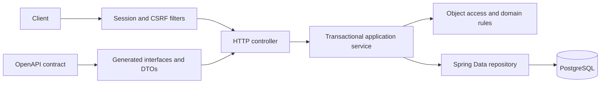
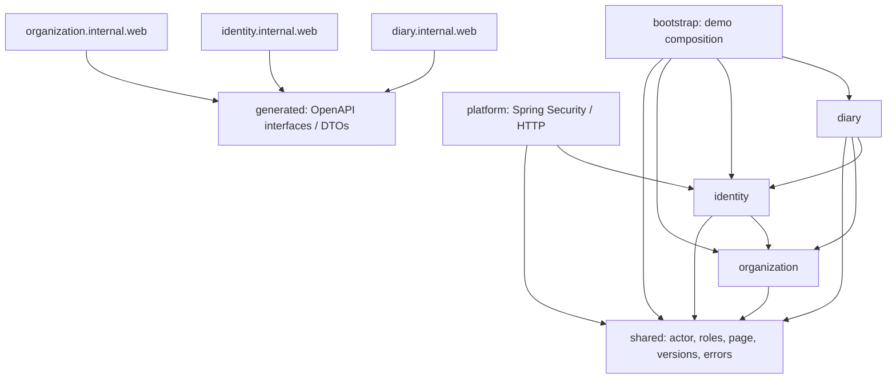

# Architecture

## Request flow

This is a modular monolith: one deployable application and one transactional database. Business code lives under `dev.schooldiary`. There are three modules, each containing its own HTTP adapters, use cases, model and persistence code. These are package modules in one Gradle project, not separate JARs.

Controllers adapt generated HTTP requests to application commands and map application views to generated responses. Services own use cases, authorization for the specific objects, business validation, and transaction boundaries. Repositories retrieve and persist aggregates. Application views contain materialized values, never managed JPA entities. Generated transport models are confined to HTTP adapters. Password hashes are absent from both application views and HTTP responses.

## Module ownership and dependencies

| Module | Owns | Why these responsibilities belong together |
| --- | --- | --- |
| `organization` | Schools, academic years and classes | They define the school structure and its calendar; classes must match the year and school. |
| `identity` | Accounts, invitations, credentials, current actor and initial administrator | Account lifecycle and authorization identity have their own rules, including one-time activation, enabled status and safe role/school changes. |
| `diary` | Subject offerings, enrollment, grades, lesson attendance and their history | Grading depends on membership and dates. Attendance captures membership under the same subject lock used by enrollment changes. |

The arrows below mean **Java compile-time dependency**, including interface implementation. Calls through injected ports may run in the opposite direction without creating a source dependency cycle.

Each module's `internal` packages are private by architectural rule. Root-package interfaces are intentional integration points; there is no facade forwarding every service method.

| Contract and owner | Purpose / implementation |
| --- | --- |
| `organization.SchoolReferences` | Managed school/year/class lookups and a locked-year lookup, implemented by `JpaSchoolReferences`. A deliberate JPA bridge. |
| `organization.AcademicUsage` | The structure asks whether a year or class is used. The diary checks current subject assignments and captured lesson classes. |
| `identity.AccountLookup` | Managed account references and account locks for diary relationships, implemented by `JpaAccountLookup`. A deliberate JPA bridge. |
| `identity.AccountCredentials` | A materialized credential snapshot for authentication; the security configuration cannot access account repositories. |
| `identity.AccountUsage` | Account updates/deletion ask whether academic records reference the account; `diary` implements the check. |
| `identity.TeacherAccountScope` | The diary contributes an enrollment `EXISTS` predicate to the account query. Filtering and pagination stay in SQL. This contract intentionally uses JPA Criteria. |

For example, `UserService` depends on the `AccountUsage` interface in its own module. `DiaryAccountUsage` implements that interface using diary-owned repositories. The account module does not import the diary or know how grades are stored. This also allows its use case to be tested with a fake or mock port.

## Authorization ownership

`platform.security` configures sessions, CSRF, authentication, route guards and the login limiter. It does not decide whether a teacher may change a particular grade. The public technical `identity.AccountPrincipal` binds a session to an immutable UUID and credential version. `identity.internal.authentication.SessionActor` reloads the account by that UUID, verifies its credential version and returns an immutable `Actor` with ID, role and school; disabled/deleted/revoked accounts remain rejected on subsequent requests. Email changes do not change session ownership.

`GradeService.history` resolves the actor once and authorizes every distinct subject/student pair before returning any history. Repeated revisions of the same grade do not repeat account and enrollment queries. An inconsistent later revision for another student or school still causes the whole read to be denied.

The former global `AccessPolicy` is split between this actor resolution, shared role/tenant checks in `CurrentActor`, and `diary.internal.application.DiaryAccessPolicy` for subject, membership and grade permissions. The former `ScopedQueries` is split into `identity.internal.persistence.UserScopes` and diary-owned `SubjectScopes` / `GradeScopes`. Enrollment-dependent teacher visibility is supplied by `DiaryTeacherAccountScope`; identity does not import the enrollment entity.

`shared` contains only `Actor`, `CurrentActor`, `UserRole`, `PageResult`, optimistic-version checking and application errors. It contains no entity, repository, subject-specific policy, generated DTO or HTTP response. It still uses Spring's `AccessDeniedException` and Spring Data's `Page` adapter; this is a Spring application rather than a framework-free domain design.

## Important rules

- A user belongs to one school, except the bootstrap global administrator.
- A school administrator's reads and writes are scoped to that school.
- Academic years, classes, teachers, students, and subject offerings must agree on school ownership.
- Teaching requires the teacher role. Participating in a subject and receiving a grade require the student role.
- Enrollment has its own lifecycle and dates. Existing grades retain their history when a student leaves a subject.
- Grade mutations record their actor and revision and use optimistic locking to detect stale updates.
- Role and school changes cannot invalidate existing teaching assignments, enrollment, or grade records.
- Deleting a referenced school or academic structure returns a conflict instead of silently removing dependent records.

The exact rejection behavior is exercised in the service and API tests. Database foreign keys and unique constraints provide a second boundary against invalid persistence.

## Enrollment lifecycle

There is one enrollment per subject and student. A second create request returns a conflict; status changes use `PUT` with the current version. `joinedOn` must fall within the academic year and cannot be in the future.

Withdrawing sets `leftOn` no earlier than joining or an existing grade or grade revision and no later than today or the end of the academic year, whichever is earlier. Reactivation changes the status back to `ACTIVE`, clears `leftOn`, and retains the original joining date. Reactivation after the academic year ends is rejected. Withdrawal preserves grade visibility and revision history.

Lesson registration shares the subject lock with enrollment changes. It records the current active roster and class for the server's current date within the academic year. Finalization and correction operate on that captured roster. Reports count finalized marks in the database and paginate the same filtered scope. An exact-email enrollment operation lets an assigned teacher enroll an enabled student from the subject's school.

## Contract and errors

`src/main/resources/openapi/openapi.json` is the source for generated interfaces and DTOs. Swagger UI loads it from `/openapi.json`. Tooling clients receive the same bytes at `/v3/api-docs` and the same document serialized as YAML at `/v3/api-docs.yaml`. A regression test compares both representations with the source, including operations handled by security filters such as logout.

Updates to schools, users, subjects, grades, years and classes share their field definitions with creation through OpenAPI `allOf`. Each update requires the current version. Account creation also requires an initial password. On account updates an omitted or null password keeps the current credentials.

The common error response contains HTTP status, a readable message, validation errors, request path, and timestamp. Exceptions are mapped centrally. Database diagnostics and stack traces stay in server logs. Each request receives a request identifier for log correlation.

## Transaction and query choices

Open Session in View is disabled. A service loads entities and maps them to immutable `*View` records within its transaction. The web mapper receives only materialized values, so accessing a LAZY relation after the transaction is unnecessary. Lists are paginated and limited to a bounded page size. Repository fetch choices should be reviewed when adding a relation: inspect SQL and query counts before using an eager relation or adding a bulk list feature.

Optimistic locking avoids silent last-write-wins behavior. It does not replace every concurrency invariant: unique constraints protect identity and enrollment, and operations spanning several relations need explicit locking or database-backed validation where applicable.

The JPA reference bridges join the caller's transaction with `Propagation.MANDATORY`; they cannot silently return detached references from a new, short transaction. Existing `saveAndFlush`, version checks, pessimistic lock acquisition and refresh order are retained. Grade mutations and their audit revisions commit in the same transaction. No table, column, enum value or Liquibase change set was changed by the package refactor.

## Explicit compromises

JPA relationships still cross module boundaries. This is **not full data/model isolation**. The five allowed source-module → foreign-entity pairs are:

- `identity` → `organization.internal.domain.School`;
- `diary` → `identity.internal.domain.User`;
- `diary` → `organization.internal.domain.School`;
- `diary` → `organization.internal.domain.AcademicYear`;
- `diary` → `organization.internal.domain.SchoolClass`.

The bridges expose these managed references to preserve foreign keys, LAZY mappings, locking and single-database transactions. They do not expose repositories or allow another module to mutate foreign entities through setters. Replacing them with IDs and immutable integration DTOs would be a separate persistence design change.

There is one composition-root exception: `bootstrap.DemoDataInitializer` invokes concrete application services and commands to build opt-in demo fixtures. ArchUnit lists its exact permitted target types. It cannot access repositories. Creating a public facade solely for fixture calls would add forwarding code without a business consumer.

See [ADR 0005](decisions/0005-business-module-boundaries.md) for the decision and alternatives.

## Verification boundaries

Fast tests cover validation, authorization, service use cases, and HTTP behavior. PostgreSQL Testcontainers tests cover the real database, migrations, and persistence constraints. H2 is a convenience for local development and fast tests, not a claim of PostgreSQL equivalence.

The build generates a coverage report for inspection. Coverage numbers alone do not establish correctness; assess the denied and conflicting paths alongside successful scenarios.

`ArchitectureTests` imports production bytecode, including MapStruct implementations. Only test classes and OpenAPI-generated classes are excluded as rule origins; dependencies on generated DTOs are still checked. It verifies that ArchUnit actually discovers the three intended business modules and their 3/2/7 JPA entities. Rules reject undeclared dependency directions, module cycles, foreign repository access, HTTP dependencies in application/model/persistence, controller access to JPA, and internal-package access outside the explicit exceptions. The actual set of foreign entity references must equal the five-pair whitelist. A deliberately invalid test fixture proves that repository and HTTP violations are detected. Run these checks with `./gradlew test --tests dev.schooldiary.architecture.ArchitectureTests` or as part of `check`.
