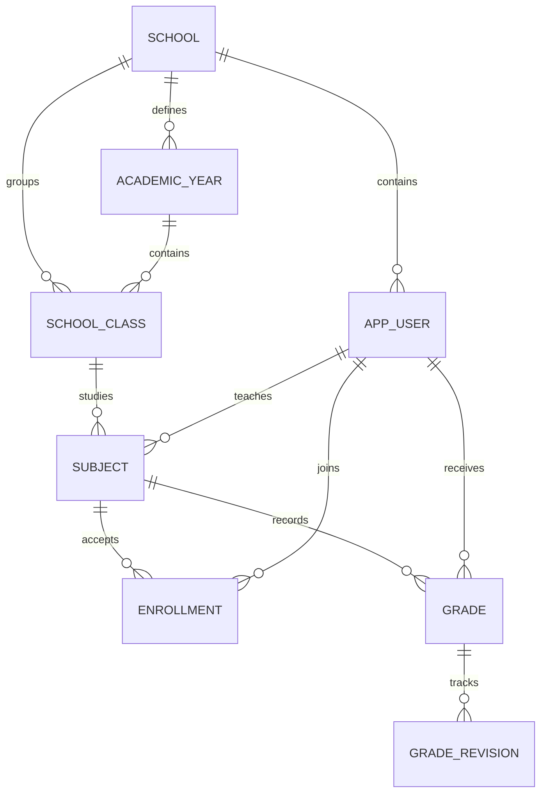

# Database and migration notes

PostgreSQL 18.6 is the normal runtime database. Liquibase is the schema authority, and Hibernate runs with `ddl-auto=validate` to detect mismatches rather than changing tables at startup.

## Relationships



The diagram presents conceptual relationships; the Liquibase changelog is authoritative for physical names, nullable legacy references, indexes, and foreign keys. A subject represents an offering taught by a teacher, rather than an independent subject catalog entry. Enrollment records describe membership and its dates and status. Grade revisions preserve the mutation actor and earlier state.

## Schema evolution

1. Append a new changeset; do not rewrite a changeset already applied to a shared database.
2. For a required column, first introduce it as nullable or with a safe backfill, migrate existing data, then add the constraint.
3. Add database constraints for invariants that can be expressed reliably in the schema, including uniqueness and references.
4. Run `./gradlew integrationTest` against PostgreSQL and test upgrade behavior using representative prior data.
5. Review the rollback or forward-fix plan before applying a data-changing migration to a shared environment.

Structural migrations run in every profile. Local demonstration data is seeded separately and only when explicitly enabled. Avoid environment contexts on schema changes that every deployment needs.

Migration `014-session-credentials-version` adds non-null `app_user.credentials_version` with default `0` for existing accounts. It preserves accounts, passwords and academic records. The counter revokes sessions after security-sensitive account changes; ordinary resource `version` continues to protect concurrent API updates independently. Existing change sets are not rewritten.

The original changesets 001–005 retain their checksums, including their historical `dev` context. Do not set a restrictive Liquibase context filter on normal startup: without a context filter those changesets run in every environment. New structural migrations are unconditional.

Legacy databases require deliberate review during upgrade:

- Invalid teacher/student roles, cross-school links, duplicate normalized emails, and future birth, school construction, or grading dates prevent the stricter migration from completing; repair the original records before retrying.
- Existing subjects receive a school-scoped academic period named `Legacy import`. Its dates span the current September–August year and all existing grade dates for the school, so it may cover several actual school years. Review these inferred assignments against the real school calendar.
- Historical enrollment joining dates use the earliest existing grade for each student/subject pair, or the import date when there is no grade. Grade creation and update timestamps use the import time, and authors are inferred from the assigned teacher. These are migration metadata rather than a reconstruction of the original history; the revision audit begins after migration.
- Existing accounts have no password hash until an administrator sets a password. The bootstrap account provides a controlled administrator; it does not assign passwords to every existing user.
- The historical `subject_students` table remains as an archive. New API operations use `enrollment` records.

Back up the existing database and test the upgrade on a copy first. Review school ownership, inferred academic years, enrollments, and account access before reopening normal use.

## Persistence and backups

Compose mounts PostgreSQL 18 data at `/var/lib/postgresql`, matching the image's major-version directory structure. `docker compose down` keeps that volume. Do not mount an older PostgreSQL data directory into a new major-version container and expect an automatic upgrade.

For a local logical backup:

```sh
docker compose exec -T db sh -c 'pg_dump -U "$POSTGRES_USER" -d "$POSTGRES_DB" -Fc' > school-diary.dump
```

Store the dump outside the repository. Protect backups as carefully as the live database. Restore into a separate empty database and verify representative accounts, enrollment, grades, and revision history before relying on the backup procedure. A persistent volume is not a backup.

Major PostgreSQL upgrades require an explicit migration procedure such as dump/restore or `pg_upgrade`. Minor updates should follow the [PostgreSQL versioning policy](https://www.postgresql.org/support/versioning/). Current image definitions are available in the [official image source](https://github.com/docker-library/postgres).
